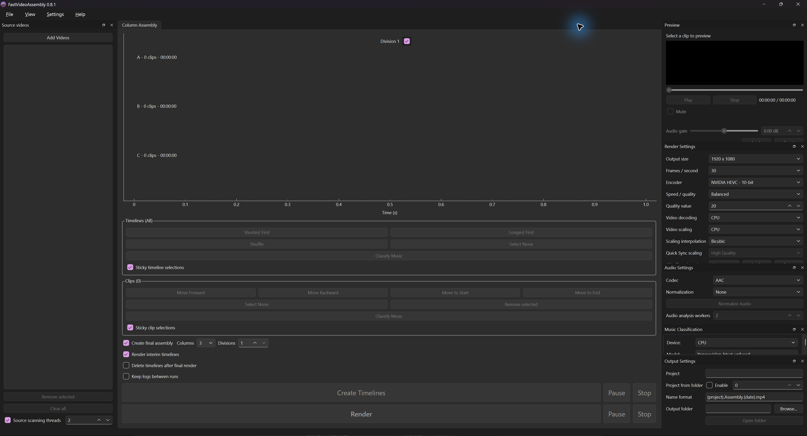

# FastVideoAssembly

Assemble portrait videos into balanced, side-by-side timelines.

## Features

- Arrange clips in three or four columns across multiple divisions.
- Preview, reorder, and shuffle clips.
- Export 1080p or 4K video with CPU or NVIDIA encoding.
- Normalize audio, adjust clip gain, and classify music and speech.

## Install

- Download the Windows `.exe` installer from [Releases](https://github.com/electblake/FastVideoAssembly/releases/latest).
- Run Setup with an internet connection, then open FastVideoAssembly from the Start menu.
- See the [user guide](docs/usage.md) or [development instructions](docs/development.md).

